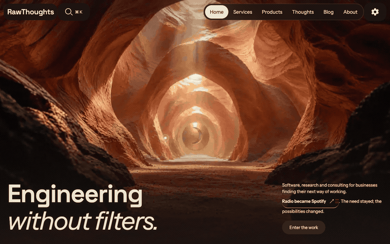

# gazette-theme-carrier

Carrier is the Gazette world used by RawThoughts. Work passes between people, objects and spaces while keeping its meaning. Warm stock, a technical display voice and a cool optical interior carry that change of carrier. [WORLD.md](WORLD.md) records the accepted opening, nine axes, page ranges and motifs still to draw.

[](https://rawthoughts.in/)

The [presentation package](presentation.toml) extends `gazette-theme-base` using the `carrier` values from `design-tokens`. Base owns shared behavior; the world supplies presentation, and the workspace supplies words, media and destinations. [Compositions](docs/compositions.md) describes the selectors, authoring forms and source bindings.

## Build and check

Bind `theme:carrier`, `theme:base` and the resources declared in `presentation.toml` in a Gazette workspace. Gazette’s `docs/theme-reference.md` describes the engine contract; Base’s `docs/start-a-world.md` describes fixture bindings and its README gives the shared verification command. This package is not a standalone site.

Change values at `design-tokens`, then run its `npm run build`, `npm run capture` and `npm run check:captures`. [Token provenance](tokens/SOURCE.md) and [font provenance](fonts/SOURCE.md) record captured inputs and licences. The delivered display, reading and system faces are WOFF2 resources.

Walk the film passage through each rest, reverse and interrupt it, then inspect its native still groups. Check service milestones, their common qualification and the separate product directory. Cover light and dark, normal and reduced motion, wide and handheld layouts, opened controls and print. A successful build establishes neither visual continuity nor design acceptance. Start with [AGENTS.md](AGENTS.md).

### Run the world fixture

`fixtures/product-guide.py` checks the product guide against Base. It runs Base's neutral reading fixture through Carrier, then adds a neutral guide to the retained workspace's nested collection and renders it again. It checks that the guide keeps Product mode, its outline and Notes without the product-detail body, and that it joins the collection deck first. It needs a Base checkout (the sibling `gazette-theme-base` by default, or `--base PATH`), the Gazette build under review and a bindings file for the `shared/` inputs declared in `presentation.toml`, in the format Base's [Start a world](https://github.com/getHarshOnline/gazette-theme-base/blob/main/docs/start-a-world.md#check-the-binding) describes:

```sh
python3 fixtures/product-guide.py --gazette /path/to/gazette --resource-bindings /path/to/bindings.json
```

It does not start a browser or check the film passage, motion or appearance; `--keep` retains the rendered workspace for inspection.

## Licence

Carrier is licensed under the MIT License with an attribution term: a site built with it keeps a footer credit stating that it was made using Gazette, such as "Made using Gazette", linking to [rawthoughts.in/gazette](https://rawthoughts.in/gazette/), and a link to this repository. [LICENSE](LICENSE) gives the full terms and the files that keep their own. The fonts are under the SIL Open Font License 1.1, with each family's licence in [fonts](fonts/).

The preview shows content from the publication this world was made for, which this repository does not license: footage and artwork purchased from a vendor under licence, and the portrait and publication art of [Harsh](https://getharsh.in). All rights reserved; not for reuse from this repository.
